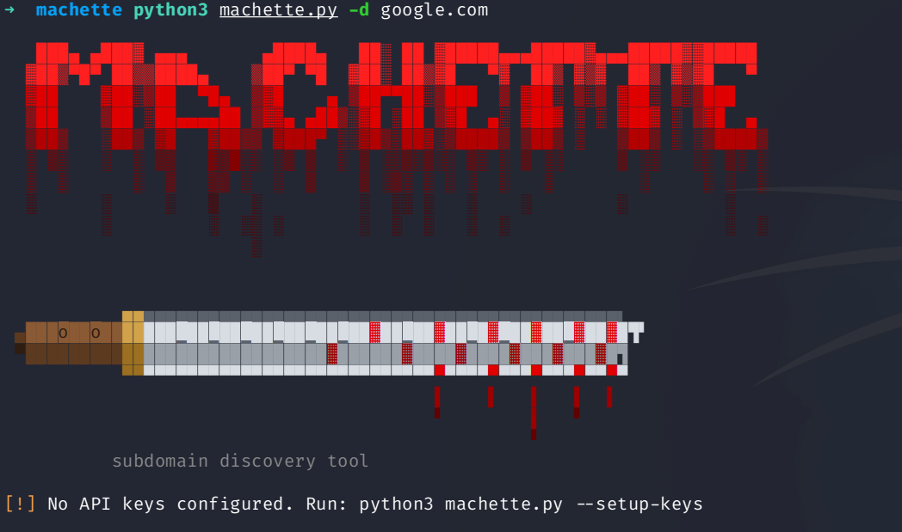

# Machette

Subdomain discovery tool — a single, plug-and-play Python file that chains
**subfinder**, **OneForAll** (passive + DNS brute force + altdns permutations)
and **dnsx** into one pipeline and writes a clean HTML report.

<p align="center">
  
</p>

It auto-installs every dependency on first run (Linux/macOS/Windows), so there
is nothing to set up by hand.

## Install

```bash
git clone https://github.com/hazartaspinar/Machette.git
cd Machette
python3 machette.py --help
```

Optional — make it callable from anywhere on Linux:

```bash
chmod +x machette.py
sudo ln -sf "$(pwd)/machette.py" /usr/local/bin/machette
```

## Quick start

```bash
# one domain
python3 machette.py -d target.com

# several domains
python3 machette.py -d target.com target2.com

# from a file (one domain per line)
python3 machette.py -l domains.txt
```

On the first run it downloads subfinder, dnsx and OneForAll automatically and
creates an example API-key file at `~/.config/machette/provider-config.yaml`.

## API keys (optional, recommended)

More sources means more subdomains. Create the config, then add your keys:

```bash
python3 machette.py --setup-keys
nano ~/.config/machette/provider-config.yaml
```

The same keys are shared automatically with both subfinder and OneForAll
(shodan, securitytrails, virustotal, censys, chaos, github, and more).

## Options

| Flag | Description |
|------|-------------|
| `-d, --domain` | Target root domain(s) |
| `-l, --list` | File with one domain per line |
| `-o, --output` | Output directory |
| `-pc, --provider-config` | Path to a provider-config.yaml |
| `--all-sources` | Use all subfinder sources (slower, more thorough) |
| `--no-oneforall` | subfinder only |
| `--no-brute` | Skip OneForAll DNS brute force / permutations (passive only) |
| `--no-resolve` | List subdomains without DNS resolution |
| `-t, --threads` | dnsx resolution threads (default 25) |
| `--timeout` | Per-tool timeout in minutes (default 30) |
| `--setup-keys` | Create the API-key config file |
| `--update` | Update subfinder, dnsx and OneForAll |

## Output

Each run writes to `machette_<domain>_<timestamp>/`:

- `subdomains.txt` — every discovered host
- `live_subdomains.txt` — hosts that resolve to an IP
- `ips.txt` — unique IPs
- `report.html` — interactive, searchable report (status, IPs, CNAME, CDN/WAF, sources)

## Requirements

Python 3.6+. Everything else installs itself.

## Legal

Only use this against domains you own or are authorised to test. You are
responsible for how you use it.

## License

MIT
